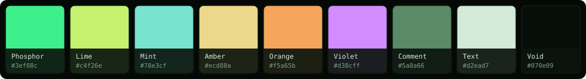

<div align="center">

# `> hacker_theme_`

**A phosphor-green terminal theme for [Zed](https://zed.dev).**
Deep green-black surfaces, glowing keywords, amber strings,
and the late-night CRT terminal feeling.


</div>

---

## Why this theme?

Most "hacker" themes are neon green on black, all the same shade.
They look great in a screenshot and wear out your eyes after an hour of real work.

Hacker Theme keeps the mood but makes the code easy to read:

- **Green means structure.** Keywords glow phosphor green, so the shape of the code stands out first.
- **Warm colors mean data.** Strings are amber and numbers are orange, so values stand apart from logic.
- **Comments step back.** They're dim and italic but still readable, passing WCAG AA contrast.
- **The interface stays out of the way.** The title bar, tabs and status bar share one near-black frame, and the editor sits a shade lighter inside it.

## The palette



| | Color | Used for |
| --- | --- | --- |
| 🟢 | `#3ef08c` **Phosphor** | keywords, tags, accents, cursor |
| 🟡 | `#c4f26e` **Lime** | functions |
| 🩵 | `#78e3cf` **Mint** | types, classes, attributes |
| 🟨 | `#ecd88a` **Amber** | strings |
| 🟠 | `#f5a65b` **Orange** | numbers, constants, booleans |
| 🟣 | `#d38cff` **Violet** | `this` / `self`, preprocessor directives |
| 🌲 | `#5a8a66` **Comment** | comments |
| ⬛ | `#070e09` **Void** | editor background |

The built-in terminal gets a matching 16-color ANSI palette, so the shell looks right too.

## Install

### The quick way

Copy the theme file into Zed's user themes folder:

```sh
mkdir -p ~/.config/zed/themes
cp themes/hacker-theme.json ~/.config/zed/themes/
```

Then press `cmd-k cmd-t` in Zed and pick **Hacker Theme**.

### As a dev extension

1. In Zed, open the command palette (`cmd-shift-p`).
2. Run **`zed: install dev extension`**.
3. Select this folder, then choose **Hacker Theme** in the theme selector.

### Make it your default

Add this to your Zed settings (`cmd-,`):

```json
"theme": {
  "mode": "system",
  "dark": "Hacker Theme",
  "light": "One Light"
}
```

## Hacking on the theme

Every color lives in [`themes/hacker-theme.json`](themes/hacker-theme.json).
If you copied it into `~/.config/zed/themes/`, Zed reloads it whenever the file
changes, so you can tweak colors and watch them update live.

The preview images in this README are generated from the theme file, so they
always match the current colors. After changing the palette, regenerate them with:

```sh
python3 scripts/render_preview.py
```

## License

[MIT](LICENSE). Fork it, remix it, make it glow.
