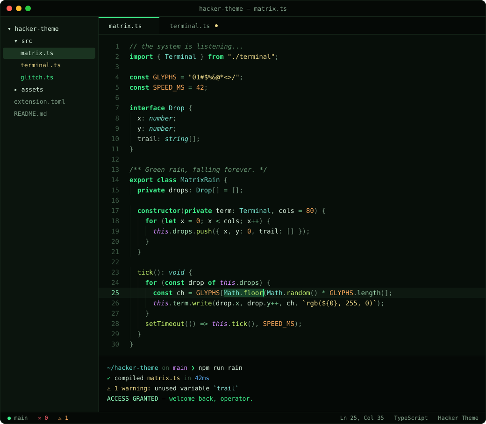

<div align="center">

# `> hacker_theme_`

**A vivid neon-green theme for [Zed](https://zed.dev).**
Pure black. Neon-green interface. Code that glows like a terminal
in a dark room.



</div>

---

## Why this theme?

Because you want your editor to look like it's breaching a mainframe, even when
you're fixing a CSS margin.

Hacker Theme goes all in on the neon, but it's still usable for real work:

- **Pure black canvas.** The editor and terminal are `#000000`, so the neon really pops (and OLED screens love it).
- **The interface glows too.** File tree, tabs, status bar and terminal text are all neon green, not just the code.
- **Green means structure.** Keywords are bold neon, and types and classes are bold cyan.
- **Warm colors mean data.** Strings are amber and numbers are orange, so values stand apart from logic.
- **Code text stays calm.** Variables are a soft near-white, so a full screen of code doesn't burn your eyes.

## The palette


| | Color | Used for |
| --- | --- | --- |
| 🟢 | `#5dff2a` **Neon** | keywords, tags, interface text, cursor |
| 🟡 | `#e6ff5c` **Acid** | functions |
| 🩵 | `#4df0e0` **Cyan** | types, classes, attributes |
| 🟨 | `#ffd966` **Amber** | strings |
| 🟠 | `#ff9f43` **Orange** | numbers, constants, booleans |
| 🟣 | `#d38cff` **Violet** | `this` / `self`, preprocessor directives |
| 🌲 | `#4fae45` **Comment** | comments |
| ⬛ | `#000000` **Void** | editor and terminal background |

The built-in terminal is neon green on black with a matching 16-color ANSI palette, so your shell fits the look.

## Install

### The quick way

Copy the theme file into Zed's user themes folder:

```sh
mkdir -p ~/.config/zed/themes
cp themes/hacker-theme.json ~/.config/zed/themes/
```

Then press `cmd-k cmd-t` in Zed and pick **Hacker Theme**.

### As a dev extension

1. In Zed, open the command palette (`cmd-shift-p`).
2. Run **`zed: install dev extension`**.
3. Select this folder, then choose **Hacker Theme** in the theme selector.

### Make it your default

Add this to your Zed settings (`cmd-,`):

```json
"theme": {
  "mode": "system",
  "dark": "Hacker Theme",
  "light": "One Light"
}
```

## Hacking on the theme

Every color lives in [`themes/hacker-theme.json`](themes/hacker-theme.json).
If you copied it into `~/.config/zed/themes/`, Zed reloads it whenever the file
changes, so you can tweak colors and watch them update live.

The preview images in this README are generated from the theme file, so they
always match the current colors. After changing the palette, regenerate them with:

```sh
python3 scripts/render_preview.py
```

## License

[MIT](LICENSE). Fork it, remix it, make it glow brighter.
